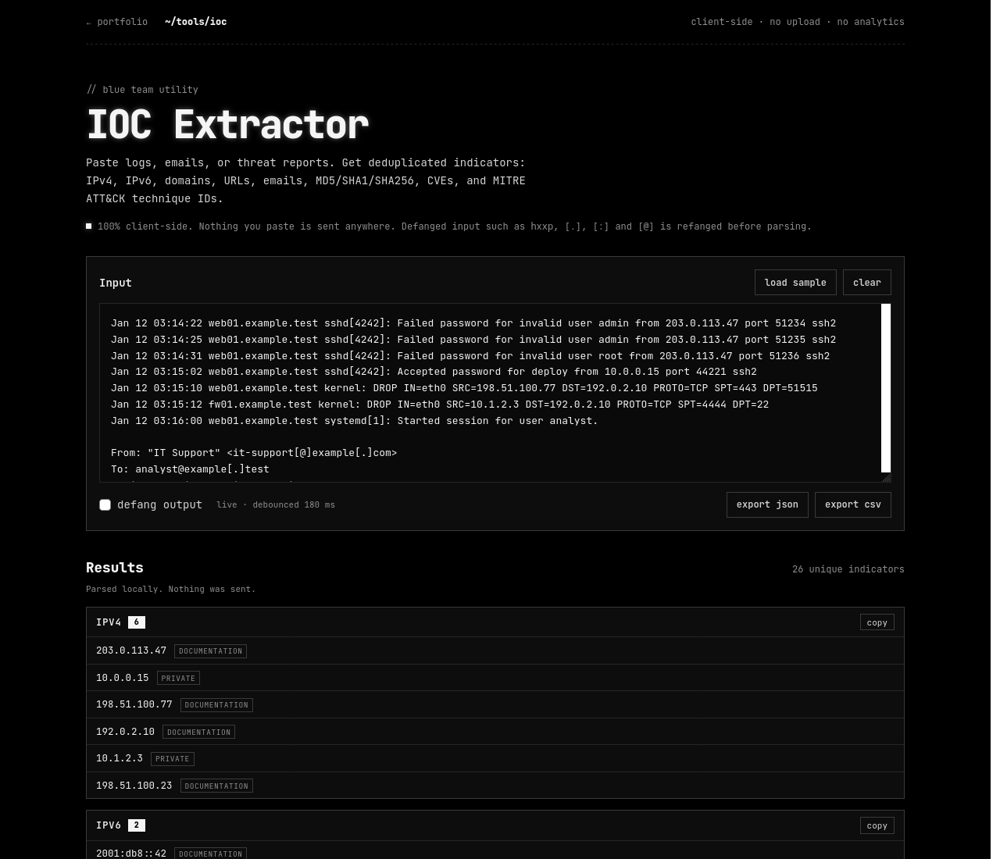

# IOC Extractor

[](https://github.com/PePy-Code/ioc-extractor/actions/workflows/test.yml)
[](LICENSE)
[](https://pepy-code.github.io/ioc-extractor/)

**Live demo → https://pepy-code.github.io/ioc-extractor/**



A small, dependency-free, **100% client-side** indicator-of-compromise extractor. Paste logs, emails, or threat reports and get deduplicated indicators grouped by type.

Built by **Saúl Bastidas ([PePy-Code](https://github.com/PePy-Code))** as a blue-team / SOC-style triage utility. Portfolio: https://pepy-code.github.io

## What it extracts

- **IPv4** — with flags for private, loopback, link-local, CGNAT, documentation, benchmark, multicast, and reserved ranges.
- **IPv6** — validates group counts so timestamps (`12:34:56`) and MAC addresses are not reported as addresses.
- **Domains** — allowlisted common TLDs; file extensions such as `.pdf`, `.js`, and `.exe` are rejected to avoid filename false positives.
- **URLs** — `http`, `https`, and `ftp`, with trailing punctuation trimmed.
- **Emails**.
- **Hashes** — MD5 (32), SHA1 (40), and SHA256 (64) by exact length, without overlapping longer hashes.
- **CVE IDs** — normalized to uppercase.
- **MITRE ATT&CK technique IDs** — `T1059` and sub-techniques such as `T1059.001`.

## Defanged input and output

Input is refanged before extraction. Supported forms include:

- `hxxp` / `hxxps`
- `[.]`, `(.)`, `{.}`, `[dot]`
- `[:]`
- `[@]`, `[at]`

The **defang output** toggle rewrites results for safe sharing (`hxxp://example[.]com`, `user[@]example[.]com`, `2001[:]db8[:][:]1`). Copy buttons and JSON/CSV exports use the current toggle state.

## Privacy

- Everything runs in the browser. Pasted text is **never sent to a server**.
- No backend, no analytics, no cookies, no external JavaScript dependencies.
- The only external request is the Google Fonts stylesheet used for JetBrains Mono; it contains no user data from the textarea.
- Export files are generated locally with `Blob` and an object URL.

## Run the tests

Requires Node.js 18+ (no dependencies, no `npm install`):

```sh
node test.mjs
```

The same tests run on every push via GitHub Actions (Node 20 and 22).

The test script imports the pure `extract()` core from `ioc.js` through Node's `createRequire`, then asserts defanged inputs, private/reserved flags, IPv6 false positives, filename/domain handling, hash length boundaries, deduplication, and the bundled sample.

## Files

| File | Purpose |
| --- | --- |
| `index.html` | Page shell, accessible labels, sample/clear/export controls. |
| `ioc.js` | UMD-ish core (`extract`, `refang`, `defang`) plus the browser UI. |
| `ioc.css` | Monochrome terminal styling, responsive down to 390 px. |
| `test.mjs` | Node assertions for the extraction core. |
| `README.md` | This document. |
| `.github/workflows/test.yml` | CI: runs `node test.mjs` on push and pull requests. |
| `docs/screenshot.png` | Screenshot used in this README. |

## Run locally

It is a static page: open `index.html` directly, or serve the folder (`python -m http.server`) and visit `http://localhost:8000`.

## Notes / limitations

- The domain allowlist deliberately favors precision over recall. Less common or new TLDs may not be recognized; add them to `TLD_ALLOWLIST` in `ioc.js` if needed.
- IPv4-mapped IPv6 addresses (`::ffff:192.0.2.1`) are not extracted as IPv6 in this version.
- The sample uses only documentation IP ranges (`192.0.2.0/24`, `198.51.100.0/24`, `203.0.113.0/24`), `example.test` / `example.com` domains, and EICAR test hashes. It contains no real victim data.
- This is a triage helper, not a malware sandbox or threat-intelligence platform. Always verify indicators before acting on them.

## License

[MIT](LICENSE) © 2026 Saúl Bastidas
